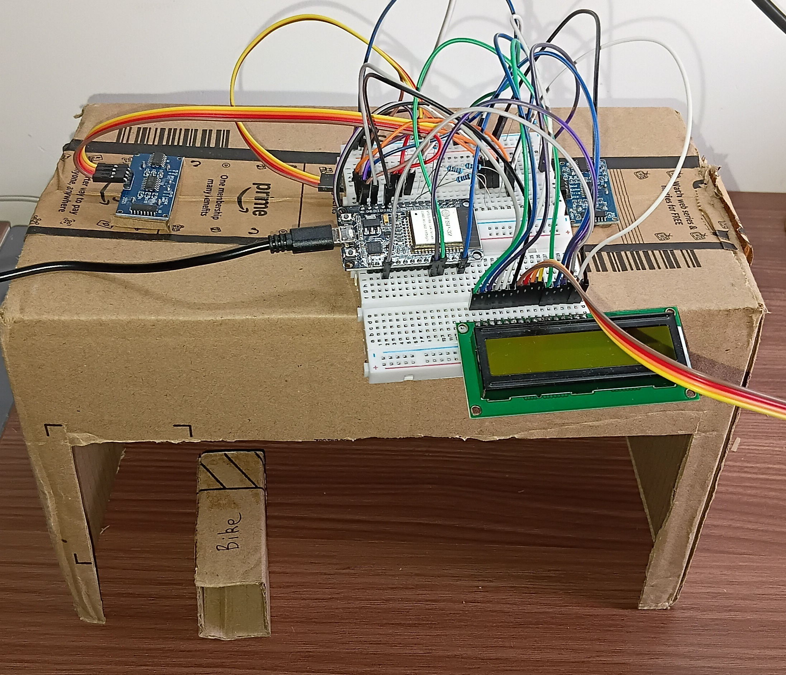
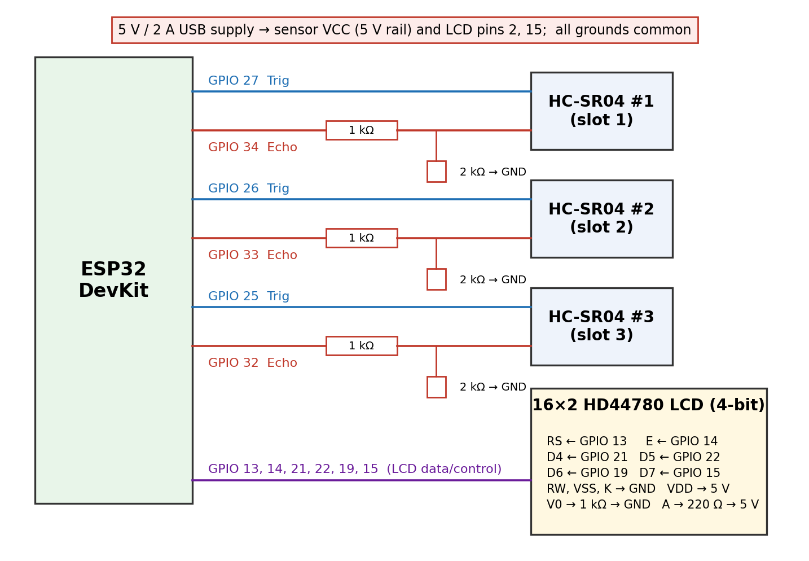

# Smart Slot: Robust Occupancy Detection for Two-Wheeler Parking with Low-Cost Ultrasonic Sensors

Code, firmware and data for the paper *Smart Slot: Robust Occupancy Detection for Two-Wheeler Parking with Low-Cost Ultrasonic Sensors* by Ansh Bhura, Jaikiruthik S, Aryan Gupta and Georgepeter Jaffino.

Smart Slot is a three-slot two-wheeler parking monitor built from an ESP32 and three HC-SR04 ultrasonic sensors. A fixed distance threshold declares a slot occupied in 89.7% of the cases in which a hand or person merely passes over it. Our detector removes this failure with a median filter, a dwell-time state machine (FREE, OBSERVING, OCCUPIED, CHECK), an adaptive baseline that tracks drift of the empty-floor reading, and a pair rule that flags a vehicle lying across two adjacent slots as mis-parked. It runs on the microcontroller and needs no training data on site. The repository contains the firmware, the 109 labelled trials, and the evaluation code that compares the detector with threshold-only detection, CUSUM, a Kalman-gated detector, a feature-based HMM and a decision tree.



## Hardware

- ESP32 DevKit
- 3 x HC-SR04 ultrasonic sensors (5 V), one per slot, mounted on a lid about 17.5 cm above the table and looking down
- 16x2 HD44780 character LCD (16-pin parallel, 4-bit mode)
- 3 x 1 kΩ and 3 x 2 kΩ resistors (echo-line voltage dividers), 1 kΩ (LCD contrast) and 220 Ω (LCD backlight) resistors
- 5 V / 2 A USB supply, breadboard, jumper wires
- Scale model: cardboard box of 27.5 cm x 15 cm, bike prop of 7.5 cm x 3 cm

### Wiring



| Signal | ESP32 GPIO |
|---|---|
| HC-SR04 trigger, slots left to right | 27, 26, 25 |
| HC-SR04 echo, slots left to right (through 1 kΩ / 2 kΩ divider) | 34, 33, 32 |
| LCD RS / E | 13 / 14 |
| LCD D4 / D5 / D6 / D7 | 21 / 22 / 19 / 15 |

Power the sensors from the 5 V rail, not from the ESP32 3.3 V pin, and connect all grounds together. The echo output of the HC-SR04 is 5 V, so every echo line needs the divider.

## Repository layout

```
firmware/    ESP32 firmware (SmartSlot/) and the hardware bring-up sketch (HardwareTest/)
eval/        evaluation and replay code (run_cv.py, ssalgos.py, ssdata.py, sens.py, ...)
trials/      the 109 recorded trials (raw distances as CSV, metadata as JSON)
report/      results of the cross-validated evaluation (results.md, CSV, JSON parameters)
figures/     figures used in the paper
```

## Flashing the firmware

1. Install the Arduino IDE and add ESP32 board support (Boards Manager, "esp32 by Espressif Systems").
2. Open `firmware/SmartSlot/SmartSlot.ino`. The file `slot_logic.h` must stay in the same folder.
3. Select your ESP32 board (for example "ESP32 Dev Module") and the correct COM port, then upload. If the upload hangs, hold the BOOT button while it connects.
4. Open the Serial Monitor to see the readings and decisions. The LCD shows the state of each slot.
5. The ESP32 runs its own WiFi access point with a dashboard, so no internet is needed. Connect your phone to the access point and open `http://192.168.4.1`. If the phone says there is no internet and switches away, turn off mobile data.

`firmware/HardwareTest/HardwareTest.ino` prints the three distances on the serial port and is the quickest way to check the wiring.

## Running the evaluation

Requires Python 3.

```
cd eval
python run_cv.py
```

This replays every trial in `trials/` through all compared methods with 5-fold cross-validation grouped by trial, and writes the results to `report/`. `sens.py` runs the calibration-error study and `validate_port.py` checks the Python replay against the firmware logic. New trials can be recorded with `collect.py` while the board is connected over USB.

## Citation

If you use this work, please cite the paper (reference to be added once published).

## License

MIT, see `LICENSE`.
